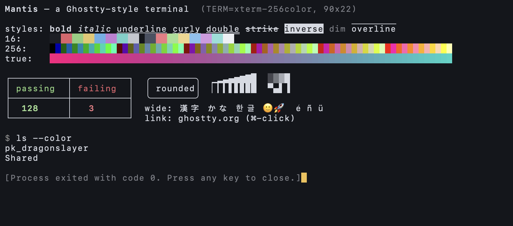
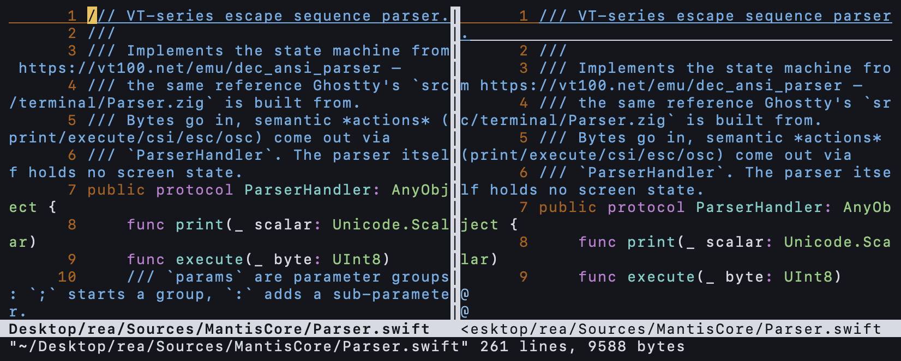
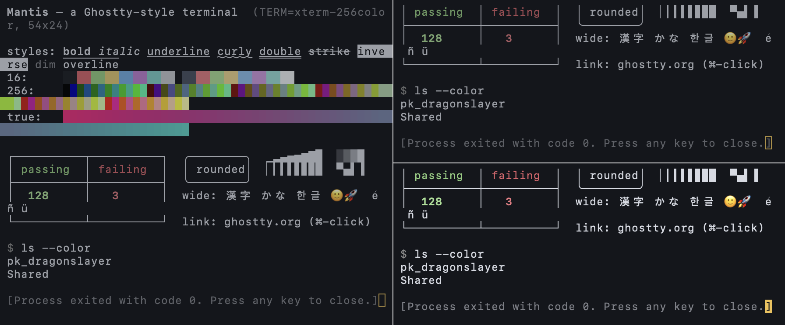
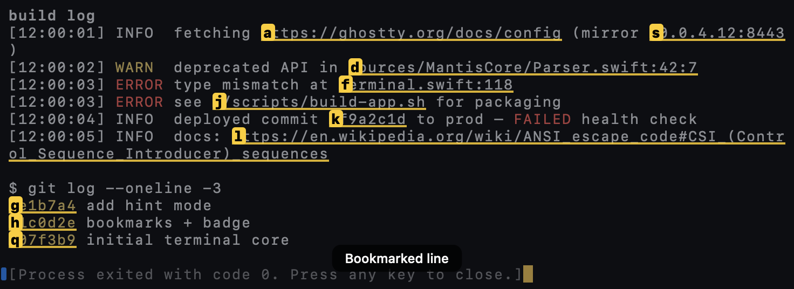
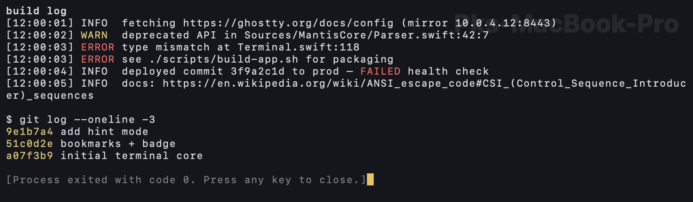
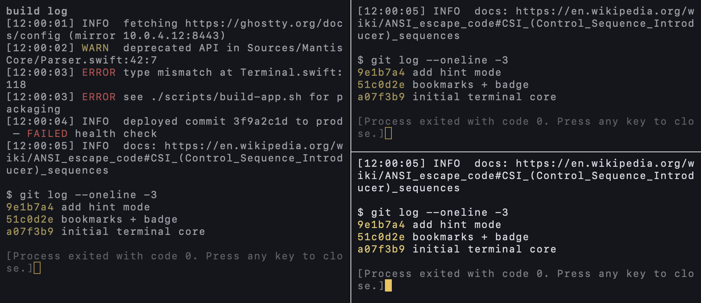

# Mantis

A native macOS terminal emulator in Swift whose architecture mirrors [Ghostty](https://ghostty.org):
a UI-free terminal core library, a C PTY shim, separate IO reader and writer threads, and a native AppKit
runtime with tabs and splits.

- **How Ghostty works, with evidence:** [docs/GHOSTTY_ARCHITECTURE.md](docs/GHOSTTY_ARCHITECTURE.md)
- **Features that could be added:** [docs/ROADMAP.md](docs/ROADMAP.md)

## Build & run
```sh
swift build && .build/debug/Mantis           # run from source
swift test                                   # 38 core tests
./scripts/build-app.sh && open dist/Mantis.app
.build/debug/Mantis -e ./scripts/demo.sh     # feature demo (colors, box drawing, wide chars, links)
```
Requires macOS 13+ and Xcode/Swift 5.9+.

## Layout
```
Sources/CPTY/            forkpty + TIOCSWINSZ shim             (≈ ghostty src/pty.c, pty.zig)
Sources/MantisCore/      no UI dependencies, unit-tested       (≈ ghostty src/terminal, src/input)
  Parser.swift           vt100.net DEC ANSI state machine + UTF-8 decoding + ASCII fast path
  Terminal.swift         screens, cursor, modes, SGR, scroll regions, OSC, resize
  Types.swift            Cell/Row/colors, ring-buffer scrollback, char width, 256-color palette
  Input.swift            key/mouse/paste encoders, selection, search
  Extras.swift           URL/path/hash/IP detection, hint labels, file:line parsing, highlight rules, HTML export
Sources/Mantis/          macOS app                             (≈ ghostty macos/ + renderer + termio)
  PTYProcess.swift       child process, reader thread, writer queue
  TerminalView.swift     renderer (CoreText + sprite box drawing), keyboard/IME/mouse, search, links
  TerminalView+Extras.swift  hints, file opening, copy-as-HTML, paste preview, bookmarks, badge, dimming, cursor trail
  App.swift              windows, native tabs, splits, menus, close confirmation
  Config.swift           ~/.config/mantis/config (Ghostty syntax) + --key=value flags
```

## Shortcuts
⌘N window · ⌘T tab · ⌘D split right · ⇧⌘D split down · ⌘[ / ⌘] cycle splits · ⌘W close pane ·
⌘C/⌘V copy/paste · ⌘F find (↩/⇧↩) · ⌘K clear · ⌘= / ⌘- / ⌘0 font size · ⇧PgUp/PgDn scroll ·
⌘-click opens links · ⌥-drag rectangular selection · ⌘, opens config

**Extras:** ⇧⌘H hint mode (type a label to open, ⇧label to copy URLs/paths/hashes/IPs) ·
⌘-click `file.swift:42:7` opens it in your editor · ⌥⌘C copy as HTML (keeps colors) ·
editable paste preview for multi-line pastes · ⌘B bookmark line, ⌘↑/⌘↓ jump ·
⌥⌘B per-pane badge · Mantis ▸ Secure Keyboard Entry · dimmed unfocused splits · cursor trail

```ini
# ~/.config/mantis/config
highlight = ERROR|FAIL(ED)?=#ff5f5f
highlight = WARN(ING)?=#e5c76b
editor = code -g {file}:{line}:{col}
badge = {host}
unfocused-split-opacity = 0.7
cursor-trail = true
```

## Verification
`MANTIS_SNAPSHOT=/path/out.png` renders the first window to a PNG and quits. This is how the screenshots
were checked headlessly. Set `MANTIS_SNAPSHOT_SPLITS=1` to split the window first.

## Screenshots (rendered by Mantis)






