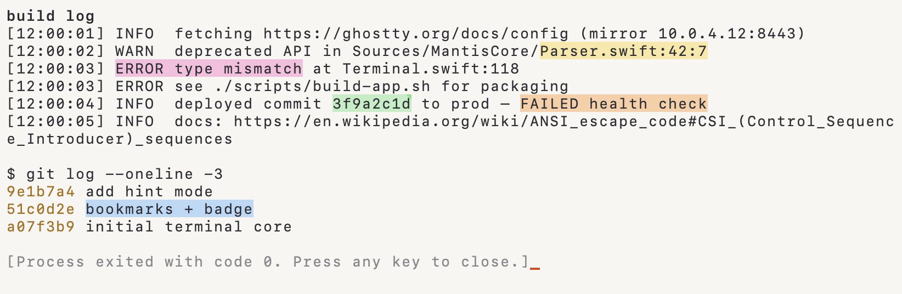
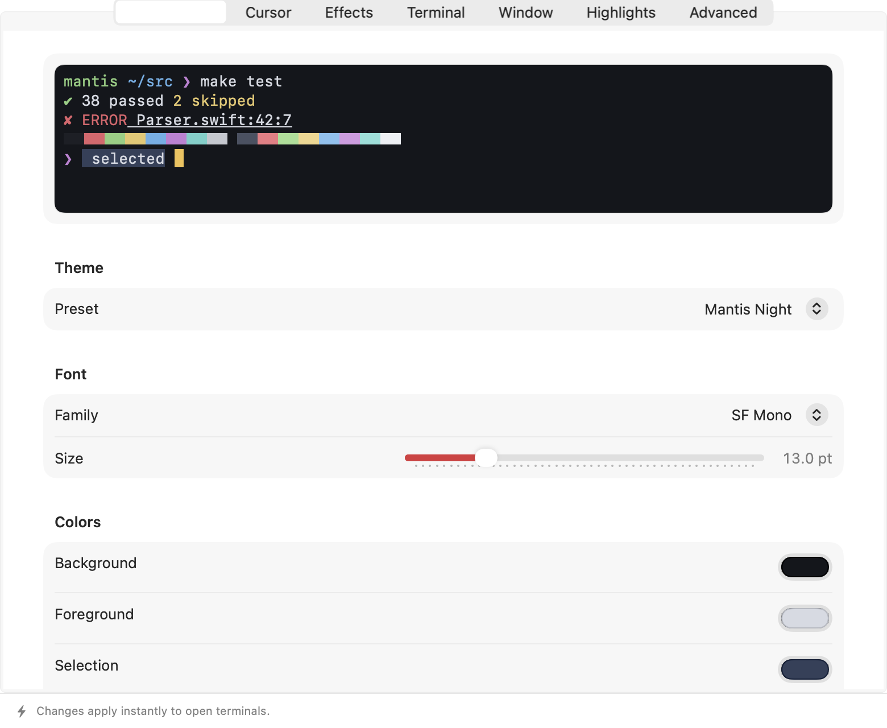
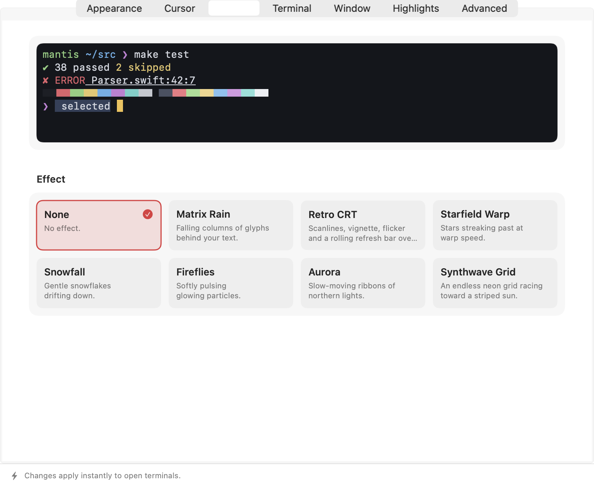
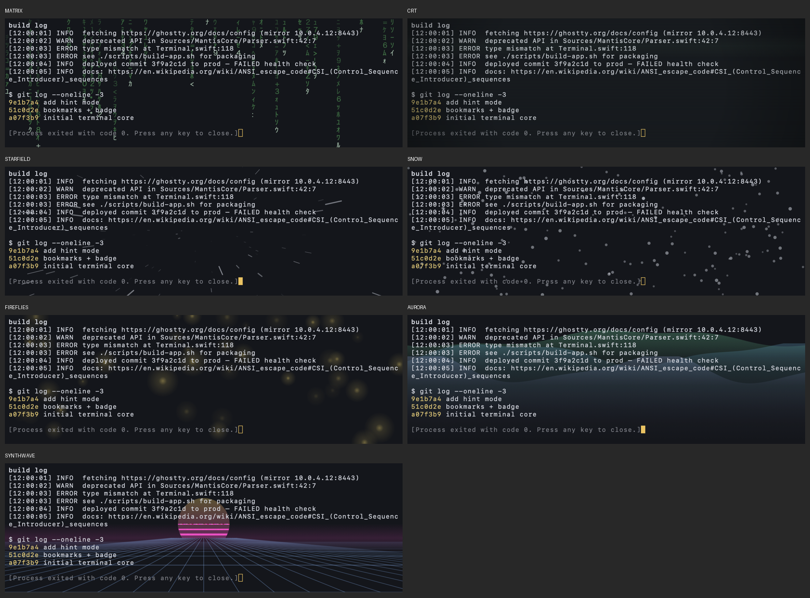

# Mantis

A native macOS terminal emulator in Swift:
a UI-free terminal core library, a C PTY shim, separate IO reader and writer threads, and a native AppKit
runtime with tabs and splits.

- **Features that could be added:** [docs/ROADMAP.md](docs/ROADMAP.md)

## Build & run
```sh
swift build && .build/debug/Mantis           # run from source
swift test                                   # 55 tests (core + app); add -c release for benchmark numbers
./scripts/build-app.sh && open dist/Mantis.app
.build/debug/Mantis -e ./scripts/demo.sh     # feature demo (colors, box drawing, wide chars, links)
```
Requires macOS 13+ and Xcode/Swift 5.9+.

## Layout
```
Sources/CPTY/            forkpty + TIOCSWINSZ shim
Sources/MantisCore/      no UI dependencies, unit-tested
  Parser.swift           vt100.net DEC ANSI state machine; SIMD ASCII scan, inline UTF-8 + CSI fast paths
  Terminal.swift         screens, cursor, modes, SGR, scroll regions, OSC, resize
  Types.swift            20-byte POD cells (+ interned graphemes), recycled scrollback rows, width table, palette
  Input.swift            key/mouse/paste encoders, selection, search
  Annotations.swift      session highlights: text-verified anchors, notes, navigation, Markdown export
  Extras.swift           URL/path/hash/IP detection, hint labels, file:line parsing, highlight rules, HTML export
Sources/Mantis/          macOS app
  PTYProcess.swift       child process, reader thread, writer queue
  TerminalView.swift     CoreGraphics renderer (dirty rows, glyph cache) + overlays, keyboard/IME/mouse, search, links
  Metal.swift            GPU renderer: glyph atlas + one instanced draw per frame (renderer = metal, the default)
  TerminalView+Extras.swift  hints, file opening, copy-as-HTML, paste preview, bookmarks, badge, dimming, cursor trail
  App.swift              windows, native tabs, splits, menus, close confirmation
  Config.swift           ~/.config/mantis/config (`key = value`) + --key=value flags, serializer for Settings
  Settings.swift         SwiftUI Settings window (live apply + autosave)
  Effects.swift          effect layer: matrix, CRT, starfield, snow, fireflies, aurora, synthwave
  Themes.swift           built-in color themes
```

## Shortcuts
⌘N window · ⌘T tab · ⌘D split right · ⇧⌘D split down · ⌘[ / ⌘] cycle splits · ⌘W close pane ·
⌘C/⌘V copy/paste · ⌘F find (↩/⇧↩) · ⌘K clear · ⌘= / ⌘- / ⌘0 font size · ⇧PgUp/PgDn scroll ·
⌘-click opens links · ⌥-drag rectangular selection · ⌘, Settings · ⌥⌘, open config file · View ▸ Effect

**Settings (⌘,):** a native window with Appearance (7 built-in themes, font, every color, the 16-color
palette, opacity, contrast, padding), Cursor, Effects, Terminal, Window, Highlights and Advanced tabs. Each tab
has a live preview where it helps. Changes apply instantly to every open terminal and are saved to
`~/.config/mantis/config` in the same `key = value` format, so hand edits keep working (⇧⌘, reloads).
A hand-written config is backed up to `config.bak` the first time Settings saves.

**Effects (View ▸ Effect):** Matrix Rain · Retro CRT · Starfield Warp · Snowfall · Fireflies · Aurora · Synthwave Grid,
each with intensity, speed, density and color. They render on their own layer at 30 fps (text isn't redrawn per frame)
and pause when the window is hidden, when Mantis is in the background, or when Reduce Motion is on.

**Session highlights (like a PDF marker):** select text and press ⌘L (or ⌥⌘1–5 for Yellow, Green, Blue, Pink,
Orange). Right-click a highlight to recolor it, add a note (shown on hover, with a corner marker), copy it, or
remove it. ⌃⌘↑/⌃⌘↓ jump between highlights, Navigate ▸ Go to Highlight lists them all, and ⇧⌘L copies every
highlight as Markdown. Highlights follow their text as it scrolls into history. If the text is overwritten (e.g.
by `clear`) they hide rather than land on unrelated output. They are kept per pane for the current session.

**Extras:** ⇧⌘H hint mode (type a label to open, ⇧label to copy URLs/paths/hashes/IPs) ·
⌘-click `file.swift:42:7` opens it in your editor · ⌥⌘C copy as HTML (keeps colors) ·
editable paste preview for multi-line pastes · ⌘B bookmark line, ⌘↑/⌘↓ jump ·
⌥⌘B per-pane badge · Mantis ▸ Secure Keyboard Entry · dimmed unfocused splits · cursor trail

```ini
# ~/.config/mantis/config
highlight = ERROR|FAIL(ED)?=#ff5f5f
highlight = WARN(ING)?=#e5c76b
editor = code -g {file}:{line}:{col}
badge = {host}
unfocused-split-opacity = 0.7
cursor-trail = true
effect = matrix                 # none|matrix|crt|starfield|snow|fireflies|aurora|synthwave
effect-intensity = 0.45
effect-speed = 1
effect-density = 0.6
effect-color = #3cf06e          # or auto
effect-pause-when-inactive = true
```

## Performance
Measured on the included benchmarks (`swift test -c release --filter "ProfileTests|ThroughputTests|RenderBench"`):

| | Start | Now |
|---|---|---|
| Output: plain text | 33 MB/s | ~240 MB/s (no newlines) · ~155 MB/s (lines) |
| Output: SGR color-heavy | 15 MB/s | ~75 MB/s |
| Output: CJK / Unicode | 10 MB/s | ~43 MB/s |
| Full-screen frame, 160×50 | 9–17 ms | Metal: ~0.4 ms CPU · CoreGraphics: 1.1–2.5 ms |
| Typing (CoreGraphics) | full redraw | only changed rows repaint |

`renderer = coregraphics` (or Settings ▸ Advanced) switches back to the CPU renderer.

## Verification
`MANTIS_SNAPSHOT=/path/out.png` renders the first window to a PNG and quits. This is how the screenshots
were checked headlessly. Set `MANTIS_SNAPSHOT_SPLITS=1` to split the window first.

## Screenshots (rendered by Mantis)






